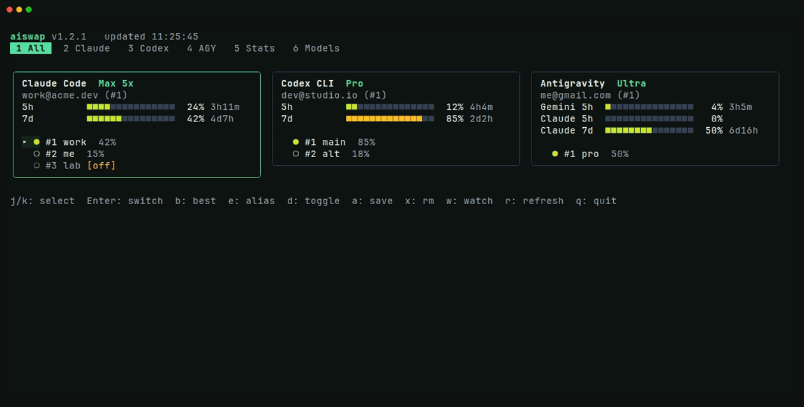

<div align="center">

# aiswap

**Zero-proxy local account switcher, quota monitor, and interactive TUI for Claude Code, Codex CLI, and Antigravity (`agy`).**

[](https://github.com/haimingx/aiswap/releases/latest)
[](https://github.com/haimingx/aiswap/actions/workflows/ci.yml)
[](go.mod)
[](LICENSE)

<br/>



</div>

---

## Why aiswap

- **Zero proxy, config swap only** — Swaps local credentials and config snapshots directly. No local HTTP proxy, no traffic interception, no third-party relay.
- **One static binary, three tools** — Manage accounts, live `5h` / `7d` shared-pool quotas, available models, and offline token stats for `claude`, `codex`, and `agy` in a single ~7 MB Go binary.
- **Crash-safe & rate-limit aware** — Follows each tool's native lock protocol, preserves machine-shared keys (e.g., Claude `mcpOAuth`), rolls back failed switches, protects one-time OAuth refresh tokens, and uses a leased cache to prevent 429 bursts.

## Install

### Homebrew (macOS & Linux)

```bash
brew install haimingx/tap/aiswap
```

### Shell installer (macOS & Linux)

```bash
curl -fsSL https://raw.githubusercontent.com/haimingx/aiswap/main/scripts/install.sh | bash
```

Verifies SHA256 checksums automatically. On macOS, installs into a writable `PATH` directory (`/opt/homebrew/bin` → `/usr/local/bin` → `~/.local/bin`), clears Gatekeeper quarantine, and applies an ad-hoc signature.

### From source

```bash
make install   # builds and installs to ~/.local/bin/aiswap
```

### Upgrade & diagnostics

```bash
brew upgrade aiswap   # if installed via Homebrew
aiswap upgrade        # if installed via install.sh (alias: aiswap update)
aiswap doctor
```

## Quick Start

```bash
aiswap                         # open interactive TUI dashboard (TTY)
aiswap watch                   # open live quota monitor
aiswap add claude --alias work # save current login to a slot
aiswap switch claude work      # switch by alias, slot number, or email
aiswap switch codex best       # auto-pick enabled slot with most quota left
aiswap status                  # live accounts, plans, and quotas
aiswap models                  # live available models grouped by shared pool
aiswap stats --days 7          # offline token usage from local logs (0 API calls)
```

## Commands

| Command | Description |
|---|---|
| `aiswap` / `aiswap tui` | Full-screen Bubble Tea dashboard (3-column panoramic layout on wide terminals) |
| `aiswap watch` | Live quota monitor with refresh countdown and in-place switching |
| `aiswap status [provider]` | Active accounts, subscription plans, and live quotas (`--refresh`, `--no-quota`, `--json`) |
| `aiswap list [provider]` | Alias of `status` (`--refresh`, `--no-quota`, `--json`) |
| `aiswap add <provider> [--alias name]` | Save or update current login in a slot |
| `aiswap switch <provider> [target]` | Switch to `<slot\|alias\|email\|next\|best>` (`--json`) |
| `aiswap alias <provider> <slot> <name\|--unset>` | Assign or clear a short alias |
| `aiswap disable` / `enable <provider> <slot>` | Exclude or include a slot in `next` / `best` rotation |
| `aiswap remove <provider> <slot>` | Remove a saved slot and its backup credential |
| `aiswap models [provider]` | Live available models per active account (`--json`) |
| `aiswap stats [--days 7\|30]` | Local-timezone token usage, model breakdown (`--breakdown`), and estimated cost (`--refresh-pricing`, `--json`) |
| `aiswap completion <zsh\|bash\|fish>` | Generate shell completion script |
| `aiswap doctor` / `upgrade` (`update`) | Environment health check and SHA256-verified self-upgrade |

Provider shorthands: `c` / `cc` (`claude`), `x` / `cx` (`codex`), `a` / `antigravity` (`agy`).

## TUI Shortcuts

| Key | Action |
|---|---|
| `1`–`6` / `Tab` | Switch views (`All`, `Claude`, `Codex`, `AGY`, `Stats`, `Models`; `u` → Stats, `m` → Models) |
| `j` / `k` (`↑` / `↓`) | Select account (Accounts) or scroll viewport (Stats / Models) |
| `Enter` | Switch to selected slot (or save current login if unsaved) |
| `b` | Switch selected provider to `best` slot (in Stats, toggles model breakdown) |
| `e` / `d` | Inline edit alias / toggle disable (in Stats, `d` toggles `7d` ↔ `30d`, `p` refreshes online pricing) |
| `a` / `x` | Save current login / remove slot (inline `y/N` confirmation) |
| `w` / `r` / `q` | Toggle Watch mode / force refresh / quit |

## Offline Token Stats

`aiswap stats` (and TUI `5 Stats`) aggregates local token usage (`Requests`, `Input`, `Output`, `Cache Read`) with **zero API calls** by scanning each tool's local JSONL session logs on the current machine:

| Provider | Local Log Path |
|---|---|
| **Claude Code** | `${CLAUDE_CONFIG_DIR:-~/.claude}/projects/*/*.jsonl` |
| **Codex CLI** | `${CODEX_HOME:-~/.codex}/sessions/*/*/*/*.jsonl` |
| **Antigravity** | `${AGY_DATA_DIR:-~/.gemini/antigravity-cli}/brain/*/.system_generated/logs/transcript.jsonl` + `~/.gemini/antigravity/brain/*/.system_generated/logs/transcript.jsonl` (CLI + IDE) |

Stats reflect local coding CLI / Agent activity only (IDE extensions sharing those directories are included automatically; standalone web/desktop chat apps are out of scope).

## Data Locations

| Platform | Backup Credentials | State & Cache |
|---|---|---|
| macOS | macOS Keychain (`aiswap.<provider>`) | `~/Library/Application Support/aiswap/` |
| Linux | `0600` files under `credentials/` | `${XDG_DATA_HOME:-~/.local/share}/aiswap/` |

Override the data directory with `AISWAP_DATA_DIR`.

## Documentation

- [Architecture](docs/architecture.md) — module boundaries, lock order, and invariants
- [Providers](docs/providers.md) — credential schemas, native locks, and quota/model endpoints
- [JSON Contract](docs/json-contract.md) — versioned `--json` payloads (`schemaVersion: 1`)

## License

[MIT](LICENSE)
